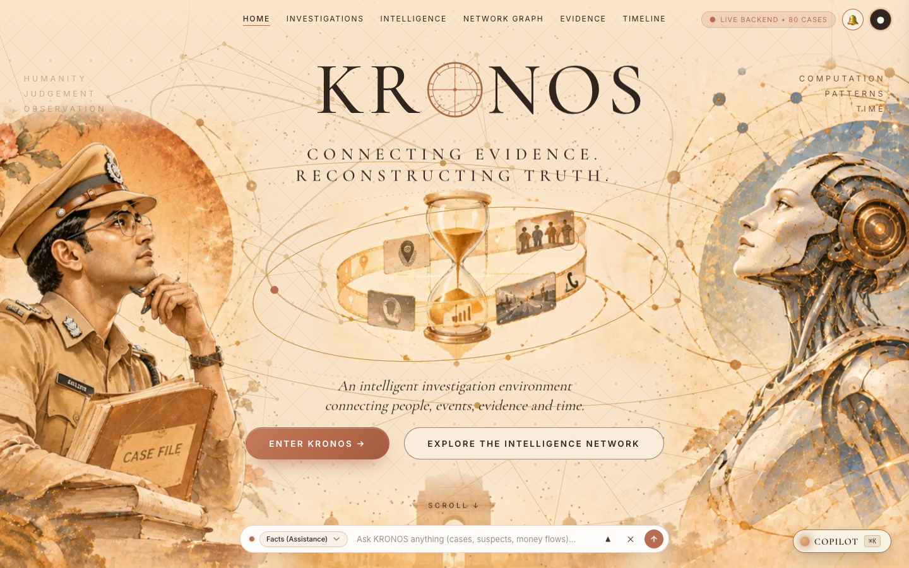
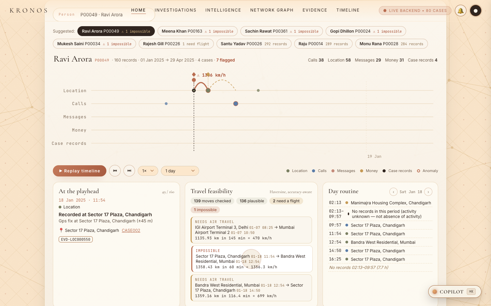
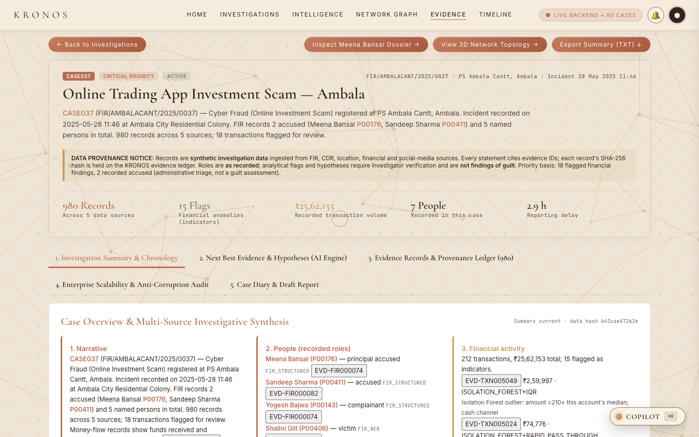
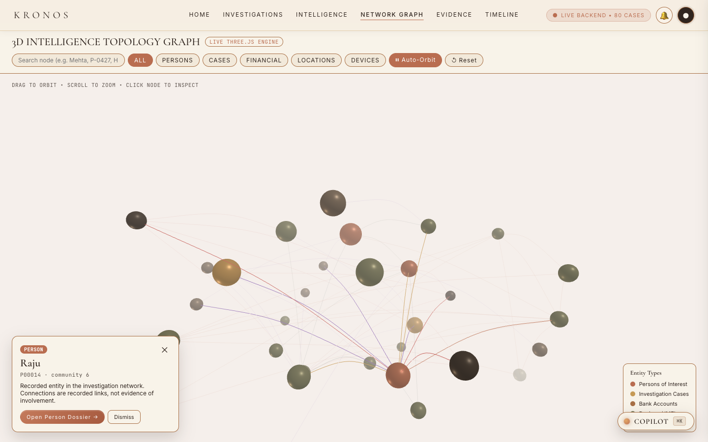

# KRONOS — Connecting Evidence. Reconstructing Truth.

**AI-assisted digital investigation platform** Problem Statement 5 · Team Nexora

[](https://github.com/chintansood/KRONOS/actions/workflows/ci.yml) — every push is installed from scratch on Linux (= Windows WSL2), Docker and macOS, and every feature is tested end to end.

KRONOS brings FIRs, call records, location data, financial transactions, social-media messages and criminal history into one
time-ordered evidence base. It analyses them with explainable engines and answers investigators' questions with a
**local** AI (Llama 3.1 8B), so no investigation data leaves the machine. Every statement it makes cites the evidence it rests on.



## What it does

| Problem Statement 5 asks for | In KRONOS |
|---|---|
| Natural-language querying, conversational assistant | Local Llama 3.1 assistant: retrieval over the evidence, citations on every point, removal of invented IDs, a grounding check. Facts mode and Detective mode. Answers in English, Hindi, Gujarati and Punjabi |
| Context-aware evidence search | Plain-language search that turns a question into explainable filters, plus full-text and vector search |
| Case summarisation, draft reports, case diary | Case summary, a 10-section draft report and a BNSS-style case diary, printable and multilingual |
| Registering new cases | **Case intake** as a 10-step form or a guided conversation with the Copilot ("add a new case"); before saving it shows people already on record and identifiers already seen in other cases. The FIR is hashed onto the ledger and analysed by every engine in about 10 seconds |
| Suspicious patterns | Financial anomalies (Isolation Forest, IQR, pass-through, structuring, fan-in), impossible travel, contact bursts, co-location, cross-case links |
| Investigative leads | Hypotheses with supporting **and** contradicting evidence, alternate hypotheses (why a person may *not* have been involved, each with the test that would settle it), investigative priority (never a guilt score), next-best-evidence recommendations |

**The five novelties:**
- **Impossible travel:** Haversine distance against time, adjusted for location accuracy.
- **Fuzzy identity matching:** combines identifiers and behaviour, and never merges records automatically.
- **Next best evidence:** recommendations ranked by a value score.
- **Federated learning + evidence ledger:** 4 agencies; SHA-256 hash chain with Merkle proofs and Ed25519 signatures.
- **Criminal-history linkage:** prior records are shown as context only.

**Also included:**
- A **Temporal Engine** on the home page: replay anyone's recorded activity and check the feasibility of every move.
- A **3D network graph** with a GNN (GraphSAGE).
- **40 real High Court cases** (pseudonymised).
- A locally **fine-tuned** model (an experiment; results below).

| Temporal engine | Case workspace | 3D network graph |
|---|---|---|
|  |  |  |

## Run it

Three ways; all three are installed from scratch and tested automatically on every push (badge above).

**Hardware:**
- 16 GB RAM is recommended for the local AI, plus about 12 GB of free disk.
- Without an NVIDIA or Apple-Silicon GPU, AI answers take 1–3 minutes instead of under a minute. Everything else is fast.
- Without [Ollama](https://ollama.com), everything works except the AI assistant.

### A. macOS
```bash
brew install python@3.12 node ollama postgresql@18 pgvector && brew services start postgresql@18
git clone https://github.com/chintansood/KRONOS.git && cd KRONOS
./setup.sh      # environment, database, AI models (~5 GB), dataset, every engine, website (~10–15 min, once)
./run.sh        # → http://localhost:8000
```
Use `postgresql@18`: Homebrew's `pgvector` supports PostgreSQL 18 and newer. Postgres.app also works.

### B. Windows 10/11 (WSL2) or Linux (Ubuntu 24.04)
1. **Windows only:** open PowerShell as administrator, run the command below, restart, then open the **Ubuntu 24.04** app:
   ```powershell
   wsl --install -d Ubuntu-24.04
   ```
   Do everything else inside Ubuntu, and clone into your Ubuntu home folder (`cd ~`), not into `/mnt/c/...`.
2. Install the prerequisites, clone, set up and run:
   ```bash
   sudo apt update && sudo apt install -y git python3.12-venv postgresql postgresql-16-pgvector nodejs npm
   curl -fsSL https://ollama.com/install.sh | sh            # the local AI (optional)
   git clone https://github.com/chintansood/KRONOS.git && cd KRONOS
   ./setup.sh      # starts PostgreSQL and creates your database user if needed (may ask for your password)
   ./run.sh        # → open http://localhost:8000 in your Windows (or Linux) browser
   ```
3. After a restart, just run `./run.sh` again. It starts PostgreSQL and Ollama if they aren't running.

### C. Docker (Windows, macOS or Linux)
With [Docker Desktop](https://www.docker.com/products/docker-desktop/) running (on Windows it uses WSL2), give it at least 8 GB of memory, then:
```bash
git clone https://github.com/chintansood/KRONOS.git && cd KRONOS
docker compose up --build        # → http://localhost:8000
```
- **First start:** downloads the AI models, generates the data and runs every engine. Allow 15–30 minutes; progress shows in the log.
- **Later starts:** take seconds.
- **NVIDIA GPU:** add `-f docker-compose.yml -f docker-compose.gpu.yml` to the command.
- **Start from scratch:** `docker compose down -v`.

### Check an installation
```bash
python3 ci/smoke.py http://localhost:8000            # 17 end-to-end checks of the API (add --llm to include the AI)
cd backend && .venv/bin/python -m pytest -q tests    # 30 tests (setup.sh route)
```

**Troubleshooting:**
- **Port 8000 is busy:** use `KRONOS_PORT=8080 ./run.sh`.
- **"PostgreSQL is not running":** macOS, `brew services start postgresql@18`; WSL/Linux, `sudo service postgresql start`.
- **"pgvector is not available":** install the pgvector package for your PostgreSQL version (see above).
- **Start the data over:** re-run `./setup.sh`, which rebuilds everything. Cases you registered through intake are re-applied.

`setup.sh` produces a reproducible synthetic investigation world (seed 42: 40 cases, about 28,000 records across 5 sources, plus
criminal history), runs every engine, loads the real court cases and builds the website.

## Using KRONOS

Open **http://localhost:8000**. The badge at the top right reads **LIVE BACKEND • 80 CASES** when everything is connected.

| Where | What to do |
|---|---|
| **Home** | Scroll the story. In **04 Temporal engine**, pick a person (try *Gopi Dhillon*), press **Replay**, and read *Travel feasibility*: impossible moves are flagged. In **05 Case intake**, register a case. The chat bar at the bottom answers questions and runs commands. |
| **Investigations** | Search and filter cases and people, open a **workspace** or a **dossier**, or press **+ New case**. |
| **Case workspace** (try `CASE002`) | 1 · Summary & chronology, with evidence IDs you can open. 2 · Next best evidence & hypotheses: priority (never a guilt score), each **line of inquiry vs alternate hypotheses**, and value-scored next steps. 3 · Evidence & provenance ledger: plain-language search; per exhibit, **Verify integrity**, **Merkle proof** and **Chain of custody**. 4 · Federated learning & ledger status. 5 · Case diary & draft report (printable, multilingual). |
| **Dossier** (try `P00023`) | Recorded activity timeline (replayable), possible same person (**Confirm / Reject / Defer**, never merged automatically), prior records (context only), next best evidence, and alternate hypotheses for the person. |
| **Network graph** | People, phones, accounts and cases in 3D. Filter by type, search, click a node, open its dossier. |
| **Copilot** (button at the bottom right, or ⌘K / Ctrl+K) | Ask in English, हिंदी, ગુજરાતી or ਪੰਜਾਬੀ. **Facts** mode answers only from recorded evidence; **Detective** mode adds hypotheses. Every point cites evidence IDs, which open the exhibit. It also runs commands: *open CASE002*, *open timeline*, *show 3D network graph*, *open case diary*. |
| **Case intake** | Form or conversation (*"add a new case"* in the Copilot or home chat). In the conversation, `skip`, `back`, `form` and `cancel` work at every step. The review shows people already on record (you choose *same person* or *keep as new*) and identifiers already seen in other cases. Registered cases can be **withdrawn** from their workspace; the ledger keeps the record. |
| **Settings** (avatar) | Interface language. |

**Questions to try:**
- *Why may P00019 not have been involved in CASE002?*
- *Which people in this case warrant further investigation?*
- *Show evidence of cash deposits above 40,000*
- *Who did P00023 communicate with most before the incident?*
- *इस मामले में किन लोगों की आगे जांच ज़रूरी है?*

**Good to know:**
- Every flag, ranking, hypothesis and link is an **investigative aid that needs human review**, not a finding of guilt.
- Roles are shown as recorded in the FIR.
- Answers from the local AI take 30–60 s on a GPU or Apple Silicon, and 1–3 min on a CPU. Everything else is instant.
- On a phone, the ☰ menu holds the navigation.
- Without WebGL (some virtual machines, remote desktops or locked-down PCs), the network graph switches to a 2D view with the same data.

## Data and privacy

- **Synthetic investigation data.** People, calls, locations, payments and messages are generated, including deliberate traps (namesakes, households sharing a phone, aliases, flights, legitimate large payments). Detectors can therefore be scored against ground truth.
- **40 real criminal cases** from Punjab & Haryana High Court orders (open dataset, CC-BY-4.0, Dattam Labs / eCourts):
  - The real FIR particulars are kept: number, date, police station, sections, outcome.
  - **Every person is pseudonymised** ([Accused A1], [Complainant C1]); phones, vehicle numbers and addresses are masked.
  - Sexual-offence, POCSO, juvenile, kidnapping, matrimonial and SC/ST cases are excluded.
  - The real people are never matched against other records.
  - The original documents and the extracted text are **not** in this repository; only the pseudonymised records are.
  - See `backend/docs/PUBLIC_RECORDS.md`.
- **Local AI only.** Answers come from Llama 3.1 running on the machine via Ollama, and nothing is sent to an external AI service.

## Results (honest)

On the synthetic ground truth, which shows the methods work as designed rather than predicting real-world accuracy:

| Check | Result |
|---|---|
| Identity matching | Precision and recall 1.0, including 4 identity switches that share no identifier; held-out worlds 0.92 |
| Impossible travel | 9 of 9 |
| Criminal-history links | Precision 1.0, no false links to same-name strangers |
| Financial anomalies | Precision 0.80, recall 0.78 |
| Evidence ledger | Verifies; tampering is detected |

For the AI assistant on 39 unseen questions:

| | Base model | Fine-tuned (QLoRA) |
|---|---|---|
| Overall pass rate | 56% | 67% |
| Abstains correctly | 50% | 100% |
| Cites the key evidence | 88% | 44% |

The base model stays the default; see `backend/docs/FINETUNING.md`.

**Not built:**
- vision and audio (ASR) pipelines;
- surveillance reports;
- Neo4j (the graph uses NetworkX);
- full sequence mining.

## Repository layout

```
frontend/   the KRONOS website (single-page app; kronos-live.js connects it to the API; premium + temporal layers)
backend/    FastAPI + PostgreSQL/pgvector + engines (ingestion, temporal, graph/GNN, identity, intelligence, LLM, ledger,
            federated, real-records pipeline, fine-tuning)  ·  docs/ has the details and screenshots
setup.sh    one-command setup        run.sh    start on http://localhost:8000
requirements.txt   software, hardware, AI models and libraries (pip install -r requirements.txt)
Dockerfile, docker-compose.yml   the container route        ci/   end-to-end smoke tests (API + browser), run on every push
```

Every analytical output is an **investigative aid with evidence references, not a finding of guilt**.
